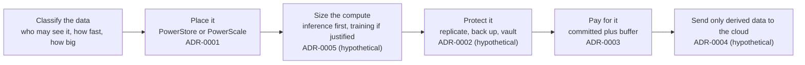

# Dell data platform for an F1 team: a presales analysis of a public story

> **Analysis of public information. Not a proposal, and no inside knowledge.** This study uses only what Dell and McLaren Racing have published about their partnership. It is not affiliated with McLaren, Dell, or Google, has not seen McLaren's environment, and the real design is probably different. Anything beyond public facts is labelled **hypothetical**. Nothing was deployed. McLaren, Dell, and Google are trademarks of their owners; no logos are used and no endorsement is implied.

## Situation
McLaren Racing has been a Dell partner since 2018 [S1]. Publicly, the team produces about 1.5 TB of data per race weekend across 23 Grands Prix in 2026 [S2] [S7]. That data runs on Dell PowerEdge servers, with PowerStore for latency-sensitive work and PowerScale for telemetry archives, video, and history [S2] [S3]. Storage is consumed through Dell APEX Infrastructure [S3]. Google Cloud is the team's Official Cloud partner, with BigQuery and Looker used for race data [S6].

Not public: how data is protected, how it moves to Google Cloud, which servers and GPUs are used, and any capacity or contract figure. This study treats those as open questions.

## Task
Explain why a team with this profile would choose these Dell products, and list what a presales architect would validate before recommending anything. The result is an analysis of a public story.

## Action
1. **Classified the data** by access pattern, speed, and sensitivity, because the product choice follows the data class.
2. **Wrote five decision records (ADRs)**, each with options, pros and cons, confidence, revisit triggers, and one analogy for non-technical readers.
3. **Kept every number in one assumptions register**, tagged Public, Calculated, or Assumed, and stated as ranges where a value is a guess.
4. **Built two small calculators** that reproduce those numbers: a capacity range and a link-sizing check.

| ADR | Decision | Analogy | Status |
|---|---|---|---|
| [0001](docs/adr/0001-data-placement-powerstore-vs-powerscale.md) | Place data by class: PowerStore for latency-sensitive work, PowerScale for large unstructured data [S10] [S11] | The race engineer's laptop (small, fast, now) versus the archive room (huge, organized) | Analysis of public facts |
| [0002](docs/adr/0002-data-protection-and-cyber-recovery.md) | Replicate, back up to PowerProtect DD, add an immutable Cyber Recovery vault [S15] | Spare parts in the truck plus a locked vault in the factory | **Hypothetical** |
| [0003](docs/adr/0003-consumption-model-apex-vs-purchase.md) | Subscribe through APEX: committed baseline plus buffer, instead of buying for peak [S14] | Spare cars already in the garage; pay only for the ones raced | Analysis of public facts |
| [0004](docs/adr/0004-cloud-analytics-and-connectivity.md) | Send derived data only to Google Cloud over HA VPN [S19] | The setup sheet stays in the garage; only the race summary goes on the pit-wall screen | **Hypothetical** |
| [0005](docs/adr/0005-compute-and-ai-placement.md) | Size AI compute by workload class: inference-class PowerEdge first, training only when justified [S26] [S27] | The pit crew (many small, fast jobs) versus the machine shop (one big, long job) | **Hypothetical** |

## Result
What exists and can be checked:
- Five ADRs and a solution design, with 27 cited sources and a clear split between public facts and hypotheses ([`docs/`](docs/)).
- Derived numbers: 34.5 TB of new data per year and 46 Mbps on average (or 0.83 Gbps in a 4 h copy window) from the 1.5 TB public figure. These are calculated upper bounds.
- Two calculators ([`app/`](app/)) covered by 15 passing tests on the math.

Main finding: the product choice follows the data class, and one eligibility detail can change an answer. For example, the APEX billing cap covers storage, data protection, and VxRail but not servers [S14].

Limits:
- This is not McLaren's design, and public figures are vendor-published and may be optimistic.
- It is not a Dell sizing or a quote. Protection overhead, growth, and data reduction are placeholders, and no Dell prices are stated because none are public.
- Nothing was deployed, load-tested, or operated.
- Scope is one slice: no trackside design, AI Factory sizing, Dell networking design, aero or CFD work, or security operations.

## Reading order
| File | Content |
|---|---|
| [`docs/solution-design.md`](docs/solution-design.md) | Scope, public facts, requirements, design diagram, assumptions register, risks, validation plan |
| [`docs/adr/`](docs/adr/) | The five decision records |
| [`docs/discovery-approach.md`](docs/discovery-approach.md) | How the assumptions would be replaced with measured data (Live Optics) |
| [`docs/sources.md`](docs/sources.md) | Every claim traced to a source and its publisher |
| [`app/`](app/) | Capacity and link calculators |

Method: ADRs follow the Nygard/MADR style and are superseded rather than edited [S22] [S23]; numbers and confidence levels follow presales practice [S24]; customer names and results appear only as already published [S25].

*Author: Muhammad Farrel Reginaldo Ahnaf ([GitHub](https://github.com/reginaldooo), [LinkedIn](https://linkedin.com/in/farrel-reginaldo)).*
