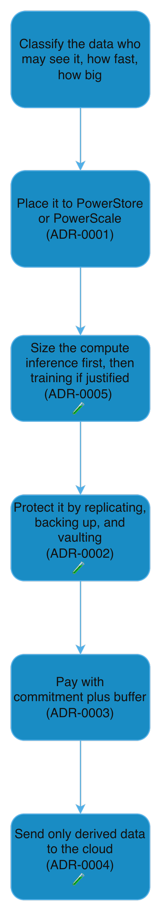

# Dell Technologies Data Platform for McLaren Racing: A Presales Analysis of a Public Story

[](https://github.com/reginaldooo)
[](https://linkedin.com/in/farrel-reginaldo)
[](https://dell-data-platform-presales-case-st.vercel.app/)
[](https://github.com/reginaldooo/dell-data-platform-presales-case-study/actions/workflows/ci.yml)
[](docs/sources.md)
[](docs/solution-design.md#10-not-covered-and-notices)

> **"How would a presales architect reason about the data platform behind the McLaren Racing Formula 1 team, using only what is public?"**

> **Analysis of public information. Not a proposal, and no inside knowledge.** This study uses only what Dell Technologies and McLaren Racing have published about their partnership. It has not seen McLaren Racing's environment, and the real design is probably different. Anything beyond public facts is labelled **hypothetical** (🧪). No Dell solution was built or deployed; only the calculators are hosted online.

## At a glance
| | |
|---|---|
| **Question** | Why would a team like McLaren Racing choose these Dell Technologies products, and what would a presales architect validate first? |
| **Method** | Classify the data, decide with ADRs, keep every number in one assumptions register, check the sizing with two calculators |
| **Produced** | 6 decision records, 1 solution design, 1 discovery plan, 2 live calculators, 30 traced sources |
| **Status** | Analysis of public information only. No Dell Technologies solution built or deployed (the calculators are hosted), no affiliation |

**Where to start**
- **2 minutes:** read [Key takeaways](#key-takeaways) and the [decision table](#decision-records).
- **10 minutes:** read the [solution design](docs/solution-design.md), then one ADR such as [ADR-0001](docs/adr/0001-data-placement-powerstore-vs-powerscale.md).
- **To see the method:** open the [live calculators](https://dell-data-platform-presales-case-st.vercel.app/) and the [discovery plan](docs/discovery-approach.md).

## Situation
McLaren Racing, including the McLaren Mastercard Formula 1 Team [S2], has been a Dell Technologies partner since 2018 [S1]. Publicly, the team produces about 1.5 TB of data per race weekend across 23 Grands Prix in 2026 [S2] [S7]. That data runs on Dell PowerEdge servers, with Dell PowerStore for latency-sensitive work and Dell PowerScale for telemetry archives, video, and history [S2] [S3]. Storage is consumed through Dell APEX Infrastructure [S3]. Google Cloud is the team's Official Cloud partner, with Google BigQuery and Looker used for race data [S6].

The story involves more than Dell Technologies. Google Cloud handles cloud analytics [S6], the trackside network uses Cisco switching [S5], and the Dell AI Factory is built with NVIDIA [S26].

Not public: how data is protected, how it moves to Google Cloud, which servers and GPUs are used, and any capacity or contract figure. This study treats those as open questions.

## Task
Explain why a team with this profile would choose these Dell Technologies products, and list what a presales architect would validate before recommending anything. The result is an analysis of a public story, not advice to the customer.

## Action

### Approach
1. **Classified the data** by access pattern, speed, and sensitivity, because the product choice follows the data class.
2. **Wrote six decision records (ADRs)**, each with options, pros and cons, confidence, revisit triggers, and one analogy for non-technical readers.
3. **Kept every number in one assumptions register**, tagged Public, Calculated, or Assumed, and stated as ranges where a value is a guess.
4. **Built two small calculators** that reproduce those numbers: a capacity range and a link-sizing check.

### Decision flow
<p align="center">
  
</p>

🧪 marks a hypothetical step, not published by Dell Technologies or McLaren Racing. This diagram shows ADR-0001 to ADR-0005; ADR-0006 (network fabric) extends ADR-0005 and appears in the high-level design below.

### High-level design
Products are as publicly described. The protection layer, the GPU fabric, and the cloud link are hypothetical.

<p align="center">
  
</p>

### Decision records
| ADR | Decision | Analogy | Basis |
|---|---|---|---|
| [0001](docs/adr/0001-data-placement-powerstore-vs-powerscale.md) | Place data by class: PowerStore for latency-sensitive work, PowerScale for large unstructured data [S10] [S11] | The race engineer's laptop (small, fast, now) versus the archive room (huge, organized) | 🟢 |
| [0002](docs/adr/0002-data-protection-and-cyber-recovery.md) | Replicate, back up to PowerProtect DD, add an immutable Cyber Recovery vault [S15] | Spare parts in the truck plus a locked vault in the factory | 🧪 |
| [0003](docs/adr/0003-consumption-model-apex-vs-purchase.md) | Subscribe through APEX: committed baseline plus buffer, instead of buying for peak [S14] | Spare cars already in the garage; pay only for the ones raced | 🟢 |
| [0004](docs/adr/0004-cloud-analytics-and-connectivity.md) | Send derived data only to Google Cloud over HA VPN [S19] | The setup sheet stays in the garage; only the race summary goes on the pit-wall screen | 🧪 |
| [0005](docs/adr/0005-compute-and-ai-placement.md) | Size AI compute by workload class: inference-class PowerEdge first, training only when justified [S26] [S27] | The pit crew (many small, fast jobs) versus the machine shop (one big, long job) | 🧪 |
| [0006](docs/adr/0006-network-fabric-for-ai.md) | Keep the site network first; add a dedicated Ethernet GPU fabric only when AI work spans several servers [S27] [S28] [S29] | The main road versus the pit lane: close off a lane only when cars must move in lockstep | 🧪 |

🟢 reasoning from public facts · 🧪 hypothetical, not published by Dell Technologies or McLaren Racing

## Result

### Key takeaways
1. **The product choice follows the data class.** Latency-sensitive databases and analysis tools suit Dell PowerStore, while large unstructured data suits Dell PowerScale, which matches both McLaren Racing's public description and Dell Technologies' own guidance [S3] [S10] [S11].
2. **One eligibility detail can change the answer.** The APEX billing cap covers storage, data protection, and VxRail, but not servers, and dark sites are not eligible [S14].
3. **The volume is small, so the link is not the hard part.** At most 34.5 TB of new data per year, 46 Mbps on average, or 0.83 Gbps if copied in a 4 h window (calculated from [S2] and [S7]; upper bounds that assume everything is kept).
4. **An availability check removed a design option.** PowerScale for Public Cloud lists AWS and Azure, not Google Cloud, so a Dell-native cloud file service on Google Cloud needs verification before it is proposed [S17].
5. **The riskiest assumptions are retention period and growth.** That is why capacity is a low, base, and high range in the calculator, to be replaced by measured data (Live Optics) and Dell sizing.

### Limits
- This is not McLaren Racing's design, and public figures are vendor-published and may be optimistic.
- It is not a Dell Technologies sizing or a quote. Protection overhead, growth, and data reduction are placeholders, and no Dell Technologies prices are stated because none are public.
- No Dell Technologies solution was built, deployed, load-tested, or operated. Only the calculators are deployed (static pages on Vercel).
- Scope is one slice: no trackside design, AI Factory sizing, detailed network design (topology, port counts), aero or CFD work, or security operations.

## Calculators
**Live: https://dell-data-platform-presales-case-st.vercel.app/**

Two small static calculators (source in [`app/`](app/)), with the math covered by 15 tests: a **capacity range** (low, base, and high usable capacity from placeholder assumptions, illustrative only) and a **link-sizing** check (share of an HA VPN tunnel used by a race weekend of data, including the one-tunnel-down case).

## Explore the repo
| Path | What it holds |
|---|---|
| [`docs/solution-design.md`](docs/solution-design.md) | Scope, public facts, requirements, design, assumptions register, risks |
| [`docs/adr/`](docs/adr/) | Six decision records |
| [`docs/discovery-approach.md`](docs/discovery-approach.md) | How assumptions would be replaced with measured data (Live Optics), plus business (SPIN) and network questions |
| [`docs/sources.md`](docs/sources.md) | Every claim traced to a source and its publisher |
| [`app/`](app/) | Capacity and link calculators (static page) |
| [`tests/`](tests/) | Unit tests for the sizing math |
| [`images/`](images/) | Decision-flow and high-level design diagrams |

## Run locally
```bash
cd app && python3 -m http.server 8765   # open http://localhost:8765
npm test                                # from the repo root
```

## Sources, attribution, and notices
All claims trace to [`docs/sources.md`](docs/sources.md). Method: ADRs follow the Nygard/MADR style and are superseded rather than edited [S22] [S23]; numbers and confidence levels follow presales practice [S24]; customer names and results appear only as already published [S25].

McLaren Racing, Dell Technologies, Google, NVIDIA, and Cisco are trademarks of their owners. No logos are used, no affiliation is claimed, and no endorsement is implied.

*Author: Muhammad Farrel Reginaldo Ahnaf ([GitHub](https://github.com/reginaldooo), [LinkedIn](https://linkedin.com/in/farrel-reginaldo)).*
