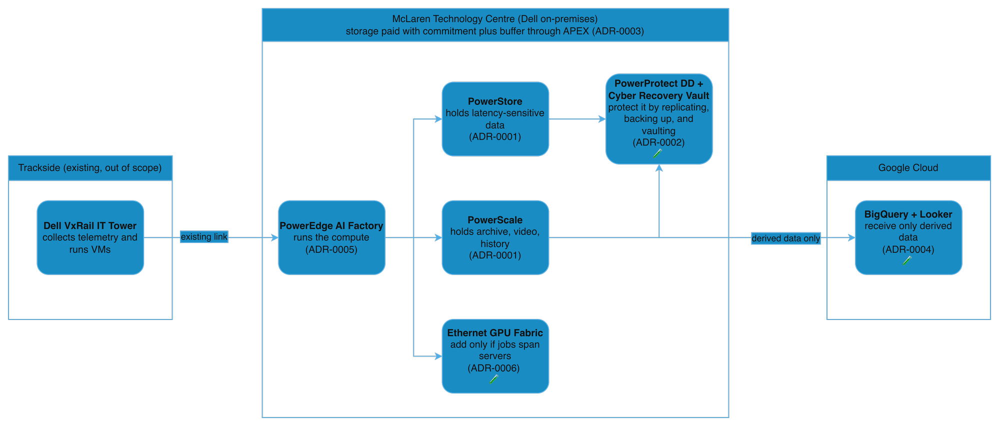

# Solution design: Dell data platform for a motorsport team (public-information analysis)

Status: Draft v1, 2026-10-23. Tags: **Public** (cited), **Calculated** (from stated inputs), **Assumed** (an assumption of this analysis, with the risk if wrong). Source IDs like [S3] point to [`sources.md`](sources.md).

## 1. Purpose and framing
This analysis covers McLaren Racing's **publicly described** use of Dell infrastructure and asks: *why would a team like this choose these products, and what would a presales architect validate first?* It is not a proposal and uses no inside knowledge. Anything beyond public facts is labelled **hypothetical**.

## 2. Scope
| In scope | Out of scope |
|---|---|
| Data platform at the McLaren Technology Centre (MTC): where each class of data lives | Trackside IT tower and the link to the MTC (already exists [S4] [S5]) |
| Data protection and cyber recovery (hypothetical) | Car design, aero, and CFD solver workloads (regulated [S9]); CFD outputs are covered only as stored data (ADR-0001) |
| Consumption model for storage | AI Factory GPU sizing, detailed network design (topology, port counts; the decision is in ADR-0006), live telemetry, security operations |
| What goes to cloud analytics and how | Google Cloud network build (VPC layout, Terraform), real deployment of anything |

## 3. What is public
| Topic | Public statement | Source |
|---|---|---|
| Relationship | Dell has partnered with McLaren since 2018 and is Official Innovation Partner | [S1] |
| Volume | About 1.5 TB per race weekend, 23 Grands Prix on the 2026 calendar | [S2] [S7] |
| Compute | Dell AI Factory including PowerEdge servers | [S2] |
| Storage | PowerStore for latency-sensitive work; PowerScale for telemetry archives, video, history | [S3] |
| Consumption | Storage is subscribed through Dell APEX Infrastructure | [S3] |
| Trackside | Dell VxRail IT tower, dedicated link to the MTC | [S4] [S5] |
| Cloud | Google Cloud is the Official Cloud partner; BigQuery and Looker are used | [S6] |
| Protection | "Built-in protection and replication" is mentioned; no product named | [S3] |

## 4. Requirements and constraints
| ID | Requirement or constraint | Tag | Risk if wrong |
|---|---|---|---|
| R1 | Faster post-race analysis for engineers | Assumed | Low: shapes priorities only |
| R2 | Keep design IP and confidential engineering data protected from other teams; this analysis keeps them on site | Public for the duty [S30] [S8]; on-site placement is Assumed | High: placement decision changes |
| R3 | Predictable spend under the cost cap | Public [S9] | Medium |
| R4 | Tier-1 data: RPO 15 min, RTO 4 h | Assumed | Medium: protection design changes |
| R5 | Link availability design target 99.99% | Assumed | Low |
| R6 | Race-operations analytics and digital-twin work run on Dell compute on site | Public [S2] | Medium: compute sizing changes |
| C1 | Existing Dell estate stays | Public [S2] [S3] | Low |
| C2 | Aero and CFD data stay on site | Public [S9], reading of the rules | High |

## 5. High-level design

  

Which product sits where is based on [S2] [S3] [S4]; the exact placement inside the MTC, the protection layer, and the cloud link design are assumptions of this analysis.

## 6. Decision log
"Analysis of public facts" means accepted as an analysis only, not as McLaren's decision.

| ADR | Decision | Status |
|---|---|---|
| [0001](adr/0001-data-placement-powerstore-vs-powerscale.md) | Place data by class: PowerStore for latency-sensitive, PowerScale for large unstructured | Analysis of public facts |
| [0002](adr/0002-data-protection-and-cyber-recovery.md) | Replicate, back up to PowerProtect DD, and add an immutable Cyber Recovery vault | Hypothetical |
| [0003](adr/0003-consumption-model-apex-vs-purchase.md) | Subscribe through APEX with committed plus buffer capacity | Analysis of public facts |
| [0004](adr/0004-cloud-analytics-and-connectivity.md) | Send derived data only to GCP over HA VPN | Hypothetical |
| [0005](adr/0005-compute-and-ai-placement.md) | Size AI compute by workload class: inference-class PowerEdge first, training only when justified | Hypothetical |
| [0006](adr/0006-network-fabric-for-ai.md) | Keep the site network first; add a dedicated Ethernet GPU fabric only when AI work spans several servers | Hypothetical |

## 7. Assumptions register (single source of truth for numbers)
Numbers elsewhere in this repo must match this table. The calculator in [`app/`](../app/) uses these defaults.

| ID | Value | Tag | Source or basis | Risk if wrong | How to validate |
|---|---|---|---|---|---|
| A1 | 1.5 TB per race weekend | Public | [S2] | Medium | Ask the customer for measured volume; run Live Optics on file and storage [S18] |
| A2 | 23 races in 2026 | Public | [S7]. Dell's page still says 22; the Formula 1 calendar shows 23 after the Bahrain race moved to Sepang | Low | Race calendar |
| A3 | 34.5 TB of new data per year (1.5 x 23) | Calculated | A1, A2. Upper bound: assumes all of it is kept | Medium | Measured retention |
| A4 | 46.3 Mbps average over a 72 h weekend | Calculated | A1 | Low | Link monitoring |
| A5 | 0.833 Gbps if copied in a 4 h window | Calculated | A1 | Medium | Throughput test |
| A6 | One HA VPN tunnel is roughly 1 to 3 Gbps | Public | [S19] | Low | Throughput test |
| A7 | History kept online for 10 years | Assumed | [S3] says history stays usable, no period given | High: capacity scales with it | Ask the customer |
| A8 | Data growth 10% per year (5% low, 20% high) | Assumed | Placeholder | High | Trend from Live Optics file profile [S18] |
| A9 | Snapshot and protection overhead 25% | Assumed | Placeholder, not a Dell figure | High | Dell sizing tools |
| A10 | Headroom 20% | Assumed | Placeholder | Medium | Customer policy |
| A11 | Data-reduction ratio 1.0 (none assumed) | Assumed | No public figure; Dell says data reduction is always on for PowerStore [S12] | Medium: real ratio lowers need | Measured on the customer's data |
| A12 | APEX buffer 20% of installed capacity | Assumed | Deal parameter, placeholder [S14] | Medium | Commercial discussion |
| A13 | Gateway about $87.60 per month in London for two tunnels | Calculated | 2 x $43.80 [S21], checked 2026-10-23 | Low | Pricing Calculator |

Capacity illustration with these placeholders (10 years, 34.5 TB per year): the calculator returns a low, base, and high range of usable capacity. It only demonstrates the method. The figures are **not McLaren's capacity** and are to be replaced by Dell sizing output.

## 8. Risks
| ID | Risk | Mitigation |
|---|---|---|
| K1 | Public numbers are vendor-published and may be optimistic | Use ranges, show assumptions, validate with measured data |
| K2 | The protection design (ADR-0002) and the cloud link design (ADR-0004) are not McLaren's | Labelled hypothetical |
| K3 | APEX eligibility differs from the reading of [S14] | Confirm with the Dell commercial team; servers are outside the billing cap |
| K4 | A single VPN device at the MTC voids the 99.99% design | Two interfaces or two devices before go-live (see ADR-0004) |

## 9. Validation plan
| Phase | Scope | Exit check |
|---|---|---|
| 1. Measure | Run Live Optics on servers, storage, file, and backup [S18]; replace assumptions A7 to A12 | Assumptions register updated with measured values |
| 2. Prove | Placement plan, restore drill, link throughput and failover test | Restore meets the 4 h RTO; link test meets the 4 h burst (assumed targets) |
| 3. Commit | Consumption model and cloud link go-live | Eligibility confirmed; sustained link use against the 50% trigger |

Metrics: restore time versus RTO, capacity used versus the plan range, and link use versus 50% of tunnel capacity. Time until post-race data is available in analytics has no target; a baseline comes first.

## 10. Not covered, and notices
Not covered: trackside design, real McLaren contracts, Dell product pricing, and anything under NDA. McLaren, Dell, and Google are trademarks of their owners. No affiliation or endorsement is implied, and no logos are used.
